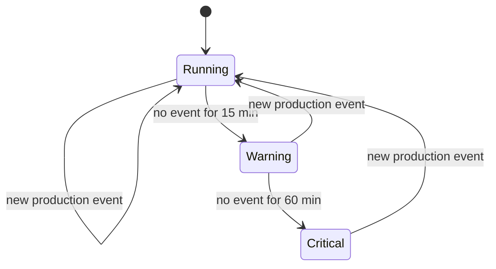
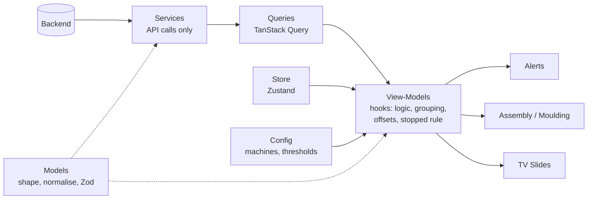

<div align="center">


# 🏭 Smart Monitoring System

**Real-time production monitoring for the shop floor, the office, and the TV wall.**


[**Overview**](#-overview) ·
[**Features**](#-features) ·
[**Quick Start**](#-quick-start) ·
[**Routes**](#%EF%B8%8F-pages--routes) ·
[**Architecture**](#%EF%B8%8F-architecture) ·
[**Structure**](#-project-structure) ·
[**Roadmap**](#%EF%B8%8F-roadmap)

</div>

---

## 📖 Overview

**Smart Monitoring** is a real-time production dashboard built for **APIPL / ABHIJEET**. It tracks **assembly** and **injection moulding (IMM)** machines on the shop floor and answers four questions at a glance:

1. **What is each machine producing right now?** (shift and day production)
2. **Has anything stopped, and for how long?** (the **Alerts** dashboard flags every machine stopped for more than 15 minutes)
3. **How did we do on any past day?** (date picker with history)
4. **Can the whole floor see it?** (full-screen **TV mode**)

Built with **Next.js (App Router)**, **React 19**, **Tailwind CSS v4** and **shadcn/ui**, following a feature-based **MVVM architecture**.

> 💡 **Tip:** Click any section marked with ▶ below to expand it.

---

## ✨ Features

| | Feature | What it does |
|---|---------|--------------|
| 🚨 | **Alerts Dashboard** | The main `/dashboard`. Separate **Assembly** and **Moulding** tabs list every machine stopped for **more than 15 minutes**, sorted by longest stopped. Turns **critical after 60 minutes**. When nothing is stopped the screen stays blank by design. |
| 📊 | **Live Machine Cards** | Shift and Day production for every machine, refreshed continuously with TanStack Query. Big gradient-blue header and stat tiles. |
| 🛑 | **Stopped-Machine Detection** | A fixed **15-minute** timeout: no new production event in that window and the machine turns red. |
| 🔍 | **Machine Detail Popup** | Click any card for OEE gauges, a breakdown chart and full machine details. |
| 📈 | **Hourly Analytics** | Hourly production bar charts (green = target met, red = below target) on the Monitoring page. |
| 📅 | **Date Picker / History** | View production for any past day. The "stopped from" indicator only shows on the live (today) view. |
| 🏭 | **Moulding (IMM) Monitoring** | Live IMM machine data polled every 15 s, plus the recent shot log (last 120 shots) below each machine. |
| ⚡ | **Instant Moulding Overview** | Previously fetched data is cached and shown immediately, with placeholder values on a first visit, so there is no loader flash. Placeholder data never raises an alert. |
| 📺 | **TV Mode** | Sidebar-free, auto-rotating slides: `/tv` for Assembly, `/tv2` for Moulding. Running production numbers are shown in green. |
| 🏢 | **Admin: Tenants, Employees, Roles** | Manage tenants, register employees and manage roles, with a dedicated admin sidebar. |
| 🧭 | **Gradient Sidebar** | Dark-blue gradient, collapsible to icons, keeps its size while you move between pages, full-size drawer on phones. |
| 🔐 | **Persistent Login** | JWT auth stored in localStorage; you stay signed in until you press logout. |
| 🛡️ | **Role-Based Access** | Super Admin guards protect sensitive pages such as employee registration. |
| 📱 | **Responsive UI** | Branded blue/cyan theme, mobile-friendly, built on shadcn/ui and Tailwind CSS v4. |

<details>
<summary><b>▶ Monitored machines</b></summary>

<br>

| Card | Machines | Notes |
|------|----------|-------|
| Aero Deflector | Aero Deflector | Shown alone |
| W610 Rear Door Cladding | RH + LH | No variant |
| W610 Rear Wheel Arch Cladding | RH + LH | **HIGH** = Pack C, **LOW** = Pack AB, grouped by variant |
| Injection Moulding (IMM) | Multiple IMM machines | Overview page plus per-machine data and shot log |

> Production values shown on assembly cards are the actual count **+1**. The offset constants live in `src/constants/all-constants.js`.

</details>

<details>
<summary><b>▶ How the Alerts dashboard works</b></summary>

<br>



Each machine is classified by `getAlertState` (`src/features/alerts/utils/alert-status.js`):

| State | Meaning |
|-------|---------|
| 🟢 `running` | An event arrived within the last 15 minutes |
| 🟠 `warning` | Stopped for **more than 15 minutes** |
| 🔴 `critical` | Stopped for **more than 60 minutes** |
| ⚪ `no-data` | No usable data from the machine |
| ⏳ `loading` | Still fetching |
| ⚠️ `time-error` | Machine timestamp is invalid or ahead of the clock |

Good to know:

- Thresholds live in `src/features/alerts/config/alerts.config.js` (`STOPPED_AFTER_MS`, `CRITICAL_AFTER_MS`).
- Assembly and Moulding each have their own tab; the header and the summary tiles follow the open area.
- The **NEW** highlight only appears after every machine has loaded, so nothing flashes at start-up.
- A 1-second clock drives the live "stopped for…" timers.
- 📅 On **past dates** the "stopped from" indicator is hidden by design. It only applies to the live view.

</details>

---

## 🚀 Quick Start

### Prerequisites

- **Node.js** 18.18 or newer
- **npm**, **yarn** or **pnpm**

### Installation

```bash
# 1. Clone the repository
git clone https://github.com/chakanabhijeet/next-js.git

# 2. The project lives in the "smart" folder
cd next-js/smart

# 3. Install dependencies
npm install

# 4. Start the development server
npm run dev
```

Then open **<http://localhost:3000>**.

### ⚙️ Environment

Create a `.env.local` file in the project root:

```env
NEXT_PUBLIC_API_URL=<your-backend-base-url>
```

> Ask the project owner for the backend base URL. Never commit `.env.local`.

<details>
<summary><b>▶ Open the app from another device on your network (LAN)</b></summary>

<br>

To open the app from a phone, a TV, or another PC on the same network (for example `http://<your-lan-ip>:3000`), `next.config.mjs` already allows the `192.168.*.*` range:

```js
// next.config.mjs
const nextConfig = {
  reactCompiler: true,
  allowedDevOrigins: ["192.168.*.*"],
};

export default nextConfig;
```

</details>

### 📜 Scripts

| Command | Description |
|---------|-------------|
| `npm run dev` | Start the dev server with webpack |
| `npm run build` | Create a production build with webpack |
| `npm run start` | Run the production build |

---

## 🗺️ Pages & Routes

| Route | Page | Description | Access |
|-------|------|-------------|--------|
| [`/`](http://localhost:3000/) | Login | Branded sign-in with remember me, show password, forgot password | Public (guests only) |
| [`/dashboard`](http://localhost:3000/dashboard) | **Alerts** | Machines stopped for more than 15 min, with Assembly / Moulding tabs | Authenticated |
| [`/dashboard/products`](http://localhost:3000/dashboard/products) | Products | Product management | Authenticated |
| [`/dashboard/settings`](http://localhost:3000/dashboard/settings) | Settings | App settings | Authenticated |
| [`/monitoring`](http://localhost:3000/monitoring) | Monitoring | Hourly production bar charts per department | Authenticated |
| [`/monitoring/assembly`](http://localhost:3000/monitoring/assembly) | Assembly Dashboard | Live machine cards, date picker, machine detail popup | Authenticated |
| [`/monitoring/moulding`](http://localhost:3000/monitoring/moulding) | Moulding Overview | Injection moulding machine grid, data and shot log | Authenticated |
| [`/tenants`](http://localhost:3000/tenants) | Tenants | Tenant management (the admin logo always links here) | Authenticated |
| [`/employees`](http://localhost:3000/employees) | Employees | Employee list | Authenticated |
| [`/employees/create`](http://localhost:3000/employees/create) | Create Employee | Register a new person (name, ID, dept, role, password) | Super Admin |
| [`/roles`](http://localhost:3000/roles) | Roles | Role management | Authenticated |
| [`/tv`](http://localhost:3000/tv) | TV Display (Assembly) | Full-screen rotating slides, no sidebar, 35 s rotation | TV kiosk |
| [`/tv2`](http://localhost:3000/tv2) | TV Display (Moulding) | Full-screen rotating IMM slides | TV kiosk |

> The links above point to your local dev server, so start `npm run dev` first.

**Monitoring sidebar:** Dashboard · Monitoring (Assembly, Moulding, each with TV) · Employees · Reports · Activities · Settings.
**Admin sidebar:** Employees (list, create) · Tenants · Roles · Settings.

<details>
<summary><b>▶ TV mode: how the slides are grouped</b></summary>

<br>

| Slide | Content |
|-------|---------|
| 1 | Aero Deflector (alone) |
| 2 | Door Cladding RH + LH |
| 3 | Wheel Arch Cladding HIGH (Pack C) RH + LH |
| 4 | Wheel Arch Cladding LOW (Pack AB) RH + LH |

Slides rotate every **35 seconds** and reuse the same view model as the Dashboard, so the numbers on the TV always match the numbers on screen in the office.

The colours are set in `src/features/tv/tv.theme.js`. For example, the running-number colour:

```js
THEMES.running.number = "text-[#00d593]"; // green
```

</details>

---

## 🛠️ Tech Stack

| Area | Technology |
|------|------------|
| **Framework** | Next.js 16.3.8 (App Router) |
| **UI Library** | React 19.2.8 |
| **Styling** | Tailwind CSS v4, shadcn/ui (base-nova) |
| **State (Server)** | TanStack Query v5 (monitoring, moulding, tenants) |
| **State (Client)** | Zustand (auth, monitoring, moulding, tenants, alerts) |
| **Forms** | React Hook Form + Zod |
| **HTTP Client** | Axios with JWT interceptors |
| **Charts** | Recharts |
| **Icons** | Lucide React |
| **Dates** | date-fns (Asia/Kolkata timezone) |
| **Auth** | JWT, persisted in localStorage |

---

## 🏗️ Architecture

The app uses a feature-based **MVVM** split. Each feature owns its own config, models, services, queries, store, view-models and views.



| Layer | Folder | Responsibility |
|-------|--------|----------------|
| **Config** | `config/` | Machine lists, thresholds, constants |
| **Model** | `models/` | Data shape, normalisation, Zod validation schemas |
| **Service** | `services/` | API calls only. No UI, no state |
| **Queries** | `queries/` | TanStack Query hooks (`useQuery`, `useQueries`, `useMutation`) |
| **Store** | `store/` | Client state via Zustand (selected area, sort order, tenants, auth) |
| **View-Model** | `view-models/` | React hooks with logic, state, grouping, calculations |
| **View** | `views/` | Pure UI. Renders what the view-model provides |

**How data flows**

1. **Services** fetch production data, **queries** cache and refresh it.
2. **View-models** normalise it, then apply offsets and the stopped-machine rule.
3. **Views** render the UI. The Alerts page, Dashboard, popups and TV slides all read from the same view models, so numbers always match.

<details>
<summary><b>▶ State management details</b></summary>

<br>

- **Zustand** – authentication (persisted to `localStorage`), plus UI state for monitoring, moulding, tenants and alerts (always read with individual selectors)
- **TanStack Query** – server-state caching (`staleTime: 60s`); moulding polls every 15 s; tenants use `useMutation` and `invalidateQueries`
- **React Hook Form + Zod** – form handling and validation
- **Styling** – Tailwind CSS v4 with shadcn/ui patterns
- **Dates** – date-fns with the `Asia/Kolkata` timezone

</details>

<details>
<summary><b>▶ Adding a new moulding machine</b></summary>

<br>

The moulding feature (`src/features/moulding`) is data-driven: a machine is described by its **device ID** and **machine ID**, and everything else (production values, status, shot log) comes from the response. Add the machine's IDs to the moulding machine config and the overview, and the Alerts page, pick it up with no change to the UI code.

</details>

<details>
<summary><b>▶ Sidebar behaviour</b></summary>

<br>

- Can be collapsed to icons; once the user changes its size it stays that way across page changes (a module-level cache, no flicker, no storage).
- It resets on reload and after logout.
- On phones it opens as a full-size drawer, even if the desktop sidebar is collapsed.
- The width is exposed as the `--sidebar-width` CSS variable.
- When collapsed, the logout button sits under the user avatar.

</details>

---

## 📁 Project Structure

```
smart-monitoring/
├── .env.local                # Local environment variables (never commit)
├── .gitignore
├── AGENTS.md                 # Rules for AI coding agents
├── CLAUDE.md                 # Instructions for Claude Code
├── components.json           # shadcn/ui configuration
├── eslint.config.mjs         # ESLint flat config
├── jsconfig.json             # Path aliases (@/)
├── next.config.mjs           # Next.js config (React Compiler, LAN origins)
├── package.json              # Dependencies and scripts
├── postcss.config.mjs        # PostCSS / Tailwind setup
├── README.md                 # This file
├── structure.txt             # Detailed folder tree & data traceability
├── public/                   # Static assets (logo, SVGs, favicon)
│   └── logo.png              # Application logo (ABHIJEET)
└── src/
    ├── app/                  # Routes and pages (Next.js App Router)
    │   ├── page.js           # Login route (/)
    │   ├── layout.js         # Root layout + QueryProvider
    │   ├── globals.css       # Global styles
    │   ├── dashboard/        # Alerts dashboard (main page)
    │   │   ├── page.js
    │   │   ├── layout.js
    │   │   ├── products/page.js
    │   │   └── settings/page.js
    │   ├── monitoring/       # Hourly analytics + department overviews
    │   │   ├── page.js
    │   │   ├── assembly/page.js
    │   │   └── moulding/page.js
    │   ├── tenants/          # Tenant management
    │   ├── roles/            # Role management
    │   ├── employees/        # Employee list + create
    │   ├── tv/page.js        # TV display: Assembly
    │   └── tv2/page.js       # TV display: Moulding (IMM)
    ├── components/
    │   ├── common/           # AppSidebar, AuthGuard, GuestGuard, RoleGuard
    │   ├── dashboard/        # DashboardHeader
    │   ├── layout/           # DashboardLayout
    │   └── ui/               # shadcn/ui primitives
    ├── config/               # Endpoints, env, constants
    ├── constants/            # Roles, routes, machine timeout, offsets
    ├── features/             # MVVM feature modules
    │   ├── auth/             # Login, JWT store, role-based access
    │   ├── alerts/           # Stopped-machine alerts (config, store, utils, view-model, view)
    │   ├── monitoring/       # Assembly production monitoring (core)
    │   ├── moulding/         # Injection moulding (IMM) monitoring
    │   ├── tv/               # TV components, hooks and tv.theme.js
    │   ├── tenants/          # Tenants (models, services, queries, store, view-models)
    │   ├── analytics/        # Hourly production charts
    │   ├── employees/        # Employee registration
    │   ├── products/         # Product management
    │   └── users/            # User management
    ├── lib/                  # Axios client, JWT decode utils
    └── providers/            # TanStack Query provider
```

> 📄 For a file-by-file breakdown with data traceability, see [`structure.txt`](smart/structure.txt).

---

## 🗺️ Roadmap

**Done**

- [x] Live dashboard with stopped-machine detection
- [x] Alerts dashboard with Assembly / Moulding tabs
- [x] Machine detail popup (OEE, breakdown)
- [x] TV mode with auto-rotating slides
- [x] Persistent login (JWT + localStorage)
- [x] Date picker with historical data
- [x] Moulding (IMM) department monitoring
- [x] Department navigation with TV sub-options
- [x] Tenants with TanStack Query and Zustand
- [x] Gradient dark-blue sidebar (monitoring and admin)

**Planned**

- [ ] Dark mode and light mode across the whole app
- [ ] Config-driven machine lists for assembly (add a machine by editing one file)
- [ ] More departments under Monitoring
- [ ] Reports and Activities pages
- [ ] Role-based access enforcement on all admin pages

---

## 🤝 Contributing

1. Fork the repository
2. Create a branch: `git checkout -b feature/your-feature`
3. Commit your changes: `git commit -m "Add your feature"`
4. Push: `git push origin feature/your-feature`
5. Open a Pull Request

---

## 📄 License

Proprietary. © **ABHIJEET / APIPL**. All rights reserved.

---

<div align="center">

Built for the shop floor. 🏭

<a href="#-smart-monitoring-system">⬆ Back to top</a>

</div>
